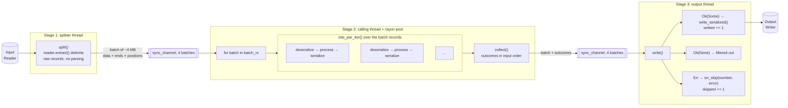
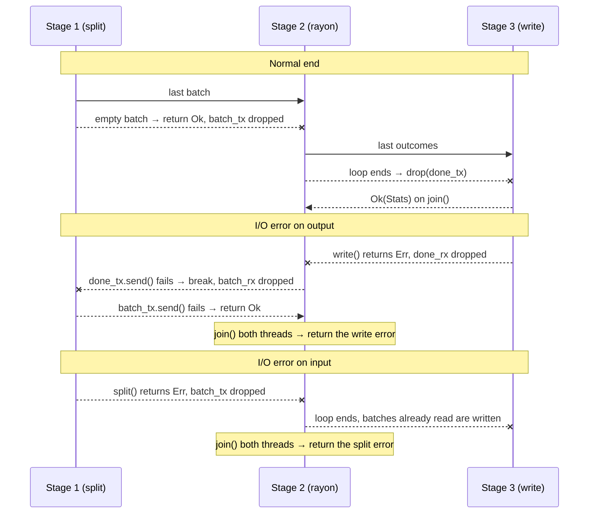

# How marcr::parallel works

`marcr::parallel::convert` (see the
[README](../README.md#parallel-processing) for its use) runs three stages
linked by bounded queues. The code is in
[src/parallel.rs](../src/parallel.rs).

- Stage 1 only finds where each record ends; parsing, the `process`
  function and serialization, the costly parts, all run in stage 2, on
  all cores.
- Rayon processes the records of a batch in any order, but `collect()`
  puts their outcomes back in input order, and batches go through the
  queues one after the other: hence the same output as a sequential loop.
- The queues are bounded: a stage that gets ahead blocks until the next
  one catches up, so only about ten batches are in memory at once.

There is no shared stop flag: a stage that stops drops its end of a
queue, and the others stop when they can no longer send or receive:

